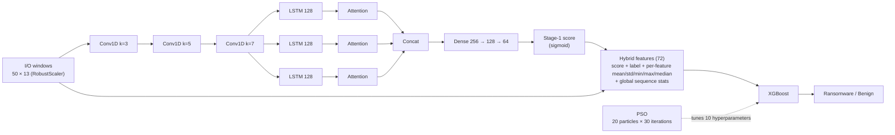
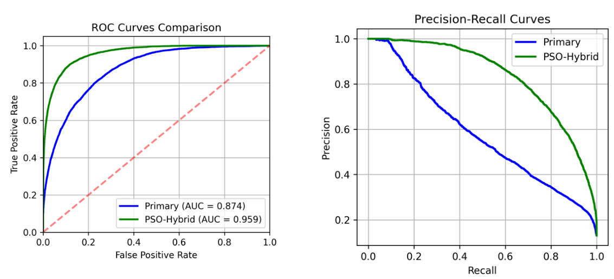
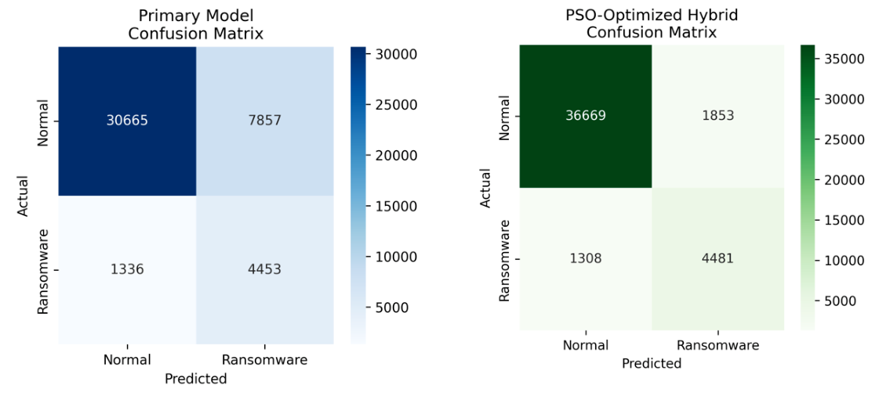

# Hybrid Ransomware Detection — PSO-Optimized CNN-LSTM-Attention + XGBoost

Behavioral ransomware detection from **storage I/O traces**. A deep temporal model
(CNN-LSTM-Attention) is stacked with an XGBoost classifier whose hyperparameters are
tuned by **Particle Swarm Optimization (PSO)**. The repository contains the training
pipeline, the trained models, a FastAPI real-time detection service with a dashboard,
a file-system monitor and a safe ransomware simulator.

> End-of-studies R&D project (Engineer + Master's degree, ESI Sidi Bel Abbès, 2025), LabRI-SBA.
> Related research article: *Hybrid Ransomware Detection: A PSO-Optimized Combination of CNN-LSTM and XGBoost* (in submission).

---

## Problem

Signature-based and heuristic detectors miss new ("zero-day") and evasive ransomware.
Learned detectors help, but on noisy, imbalanced data they usually trade **recall**
(a missed attack is very costly) against **precision** (too many false alarms make a
detector unusable). This project targets high recall while keeping precision acceptable.

## Architecture

Input: sequences of **50 consecutive 5-second windows × 13 I/O features**
(read/write ratios, entropies, working-set size, burstiness, …; see [data/README.md](data/README.md)).



1. **Stage 1, CNN-LSTM-Attention.** Three stacked 1D convolutions (kernel sizes 3, 5, 7,
   with batch norm) extract local I/O patterns. Three parallel LSTM branches, each with its
   own attention layer, model their evolution over time. A dense head outputs a ransomware
   probability. Training uses class weights and early stopping on a custom **F2-score** metric.
2. **Stage 2, XGBoost.** The stage-1 probability and its thresholded label are combined
   with 70 statistical features of the scaled sequence (72 features in total) and
   classified by XGBoost.
3. **PSO hyperparameter search.** PSO (w = 0.7, c1 = c2 = 1.5) searches `max_depth`,
   `learning_rate`, `n_estimators`, `subsample`, `colsample_bytree`, `min_child_weight`,
   `reg_alpha`, `reg_lambda`, `gamma` and `scale_pos_weight` on the validation set,
   maximizing a fitness that favors recall without sacrificing precision:

   **fitness = 0.7 × F2-score + 0.3 × Precision**

## Results

PSO-optimized hybrid model, 5-second windows, sequences of 50 (thesis Tables 6.8 and 6.9):

| Dataset | Accuracy | Precision | Recall | F2-score | AUC |
|---|---|---|---|---|---|
| DeftPunk (cloud, ~7 % ransomware) | 92.87 % | 70.75 % | 77.41 % | 75.97 % | 95.95 % |
| RansMap2024 (PC, ~52.4 % ransomware) | 84.83 % | 80.22 % | **93.49 %** | **90.50 %** | 94.60 % |

On both datasets the hybrid model beats the CNN-LSTM baseline on every metric. On DeftPunk,
precision goes from 36.17 % to 70.75 % without losing recall.





The full experimental journey, the RansMap2024 figures and the state-of-the-art comparison are in
[results/README.md](results/README.md).

## Repository structure

```
├── training/              # Training pipeline (from newTraining.py)
│   ├── layers.py          #   F2Score metric, AttentionLayer (custom Keras objects)
│   ├── pso_optimizer.py   #   PSO for XGBoost hyperparameters
│   ├── data.py            #   sequences, scaling, splits, hybrid features
│   ├── model.py           #   CNN-LSTM-Attention + PSO-XGBoost hybrid model
│   ├── evaluate.py        #   test-set metrics and figures
│   ├── persistence.py     #   save/load artifacts, training report
│   ├── train.py           #   CLI entry point
│   └── config.yaml        #   hyperparameters used for the published model
├── app/                   # FastAPI real-time detection service
│   ├── main.py            #   routes, WebSocket, dashboard
│   ├── detector.py        #   I/O monitoring, 13-feature computation, detection loop
│   ├── model_manager.py   #   loads models/ and runs hybrid inference
│   ├── schemas.py, config.py
│   └── static/dashboard.html
├── monitor/               # File-system / process monitor → /api/predict/trace
├── simulation/            # Safe ransomware simulator + thesis defense demo
├── models/                # Trained artifacts (.h5, XGBoost .pkl, 2 scalers), see models/README.md
├── predict.py             # Batch prediction on a CSV
├── data/README.md         # Dataset description (datasets not included)
├── results/               # Figures and reports from training
└── requirements.txt
```

## Installation

Python **3.10** is required (TensorFlow 2.10, which saved the model, supports ≤ 3.10).

```bash
python3.10 -m venv .venv && source .venv/bin/activate
pip install -r requirements.txt
# macOS only: XGBoost needs the OpenMP runtime
brew install libomp
```

## Train

Put the dataset CSV in `data/` (format in [data/README.md](data/README.md)), then:

```bash
python -m training.train --data data/full_dataset_5s.csv --config training/config.yaml
```

Checkpoints, figures, the saved artifacts and a text report are written to `outputs/`.
To deploy a new model, copy the `.h5`, `_xgboost_`, `_scaler_` and `_xgb_scaler_` files
into `models/`, replacing the current set.

## Predict

```bash
python predict.py my_windows.csv --output predictions.csv
```

The CSV needs the 13 feature columns. Optional columns are `file` (one stream per trace)
and `start_time` (window order). Each stream is cut into 50-window sequences with 70 %
overlap. Shorter streams are front-padded. The output has the stage-1 score, the hybrid
score and the final label.

## Run the detection app

```bash
uvicorn app.main:app --host 127.0.0.1 --port 8000
```

- Dashboard: <http://127.0.0.1:8000/dashboard>
- API docs (Swagger): <http://127.0.0.1:8000/docs>
- WebSocket: `ws://127.0.0.1:8000/ws`

Main endpoints:

| Method | Path | Purpose |
|---|---|---|
| GET | `/api/status` | System status and loaded model info |
| POST | `/api/load-models` | (Re)load models (defaults to `models/`) |
| POST | `/api/start-detection`, `/api/stop-detection` | Built-in psutil-based detection loop |
| POST | `/api/predict` | Score one set of 13 features |
| POST | `/api/predict/trace` | Score a batch of raw file operations of one process |
| GET | `/api/detections`, `/api/processes` | Recent detections, monitored processes |
| GET | `/api/model-status`, `/api/list-model-files`, `/api/debug-load-test` | Diagnostics |

The built-in loop only sees per-process I/O counters from `psutil`, so it synthesizes
file events from them. Real file events come from the monitor:

```bash
python -m monitor.windows_monitor http://127.0.0.1:8000
```

### Simulation and defense demo

```bash
python -m simulation.simulation_system http://127.0.0.1:8000   # interactive simulator
python -m simulation.defense_demo                               # scripted thesis demo
```

The simulator is **safe**. The only files it creates or renames are inside
`simulation/simulation_files/`, and it never encrypts, overwrites or deletes user
files. Its "locker" and "wiper" scenarios only report virtual I/O events to the API.

## Tech stack

Python 3.10 · TensorFlow/Keras 2.10 · XGBoost · scikit-learn · NumPy · Pandas ·
Matplotlib/Seaborn · FastAPI · Uvicorn · WebSockets · psutil · watchdog · Chart.js

## Author

**Mohammed Houssameddine Kebbas**, ESI Sidi Bel Abbès.
Supervisors: **Dr M. S. Bendella** and **Dr H. Bensenane**.
Contact: mh.kebbas@esi-sba.dz

## License

[MIT](LICENSE)
