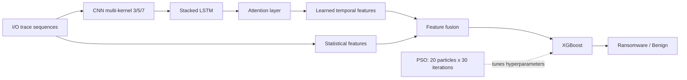

# Hybrid Ransomware Detection — PSO-Optimized CNN-LSTM + XGBoost

Behavioral ransomware detection from **storage I/O traces**, combining a deep temporal model with a gradient-boosted classifier tuned by **Particle Swarm Optimization**.

> End-of-studies R&D project (Engineer + Master's degree, ESI Sidi Bel Abbès, 2025) — LabRI-SBA.
> Related research article: *Hybrid Ransomware Detection: A PSO-Optimized Combination of CNN-LSTM and XGBoost* (in submission).

**Real-time detection app built on this model:** [ransomware-detection-app](https://github.com/kebbas-Houssam/rsw-detection-app)

---

## Problem

Signature-based and simple heuristic detectors fail against new ("zero-day") and evasive ransomware. AI models help, but on noisy and imbalanced data they usually trade **recall** (missing an attack is very costly) against **precision** (too many false alarms make a detector unusable).

## Approach



1. **Stage 1 — CNN-LSTM-Attention.** Parallel 1D convolutions (kernel sizes 3, 5 and 7) capture local I/O patterns, stacked LSTMs model their evolution over time, and an attention layer weights the most informative time steps. The model is trained with a custom **F2-score** metric.
2. **Stage 2 — XGBoost.** The learned temporal features are fused with raw statistical features of the sequence and fed to an XGBoost classifier.
3. **PSO hyperparameter search.** XGBoost hyperparameters (depth, learning rate, etc.) are optimized by PSO with a custom fitness function that favors recall without sacrificing precision:

   `fitness = 0.7 × F2-score + 0.3 × Precision`

## Results

Evaluated on two heterogeneous datasets (one imbalanced, one balanced: DeftPunk and RansMap2024):

| Metric | Score |
|---|---|
| Recall | **93.49 %** |
| F2-score | **90.50 %** |
| Accuracy | 84.83 % |

The hybrid model generalizes better than single-model baselines and gives a better detection / false-alarm trade-off.

## Repository

| File | Content |
|---|---|
| `newTraining.py` | Full pipeline: data preparation, CNN-LSTM-Attention model, feature fusion, PSO optimizer for XGBoost, evaluation and plots |

## Run

```bash
pip install tensorflow xgboost scikit-learn pandas numpy matplotlib
python newTraining.py
```

The datasets are not included (size and licensing). By default the pipeline reads `./5s/full_dataset_5s.csv` (see `main_pso_training_pipeline`).

## Tech stack

Python · TensorFlow/Keras · XGBoost · scikit-learn · Pandas · NumPy · Matplotlib

## Author

**Mohammed Houssameddine Kebbas** — supervised by Dr M. S. Bendella and Dr H. Bensenane (ESI Sidi Bel Abbès).
