# Results

All numbers and figures below are taken from the engineering thesis
(*Détection de Ransomwares par une Approche Hybride d'Apprentissage Profond Basée sur
l'Analyse Comportementale*, ESI Sidi Bel Abbès, 2025). Nothing here was regenerated.

Setup: storage I/O traces are cut into **5-second windows** described by 13 features, and
the model reads **sequences of 50 consecutive windows** (250 s). Two datasets are used:
**DeftPunk** (cloud servers, highly imbalanced, about 7 % ransomware) and **RansMap2024**
(workstation, balanced, about 52.4 % ransomware).

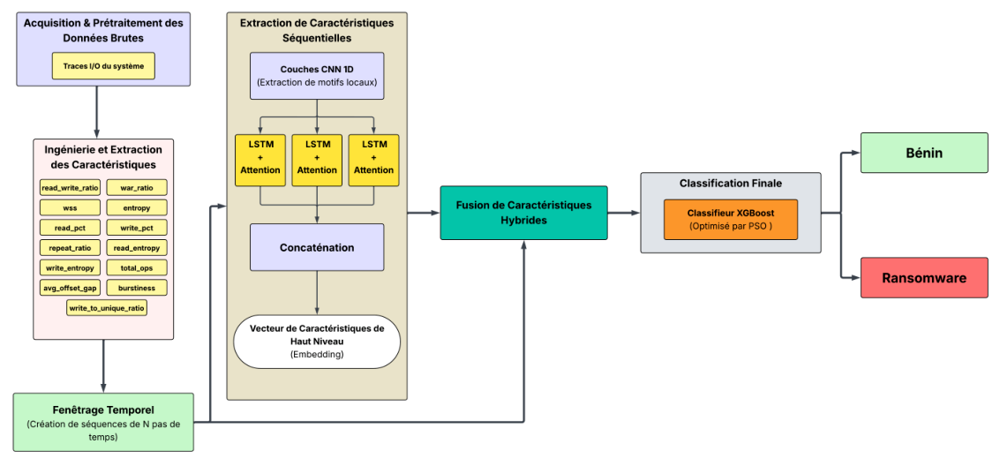
*Overall pipeline: 13-feature windows → CNN-LSTM-Attention → hybrid features → PSO-tuned XGBoost (thesis Fig. 4.1).*

## Experimental journey (DeftPunk, 5 s window)

1. **4 basic features**, full 33 GB dataset (Table 6.3): Accuracy 70.95 %, Precision 28.56 %, Recall 81.50 %, F2 59.46 %, AUC 84.39 %.
2. **13 engineered features**, CNN-LSTM only (Table 6.6): Accuracy 75 %, Precision 32 %, Recall 80 %, F2 61 %, AUC 86 %.
3. **Hybrid CNN-LSTM + XGBoost**, default hyperparameters (Table 6.7): Accuracy 90.43 %, Precision 63.84 %, Recall 61.79 %, F2 62.45 %, AUC 92.45 %.
4. **Hybrid + PSO-tuned XGBoost** (Table 6.8): Accuracy 92.87 %, Precision 70.75 %, Recall 77.41 %, F2 75.97 %, AUC 95.95 %.

Table 6.7: baseline vs. hybrid (5 s window)

| Metric | Baseline (CNN-LSTM) | Hybrid (with XGBoost) |
|---|---|---|
| Accuracy (%) | 76.97 | **90.43** |
| Precision (%) | 33.90 | **63.84** |
| Recall (%) | **80.34** | 61.79 |
| F2-Score (%) | 51.12 | **62.45** |
| AUC (%) | 87.12 | **92.45** |

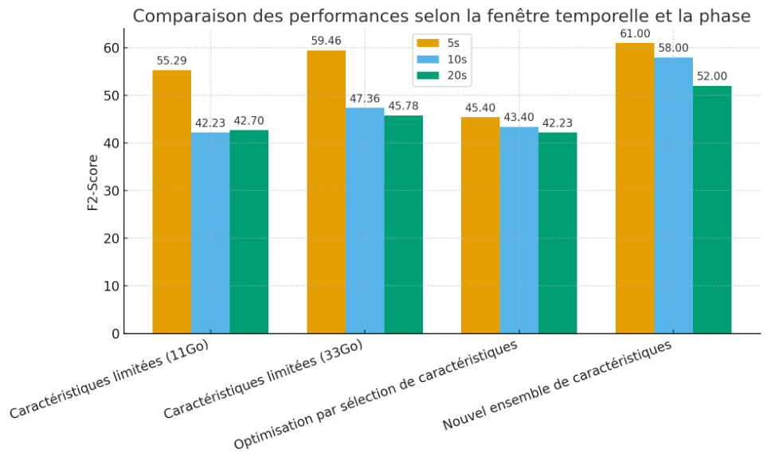
*F2-score for 5 s, 10 s and 20 s windows across the feature-engineering phases; 5 s is best throughout (thesis Fig. 6.6).*

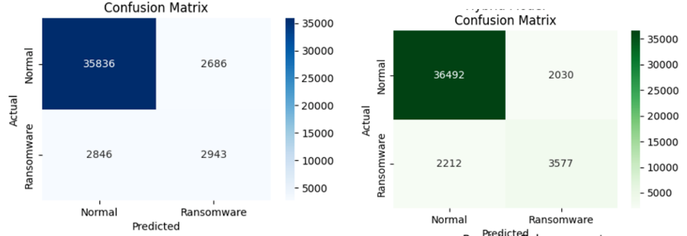
*Confusion matrices of the CNN-LSTM baseline (left) and the hybrid model with default XGBoost (right) (thesis Fig. 6.7).*

> Note: the counts in the left matrix reproduce the 51.12 % F2 of Table 6.7, but not its
> baseline accuracy, precision and recall (76.97 / 33.90 / 80.34).

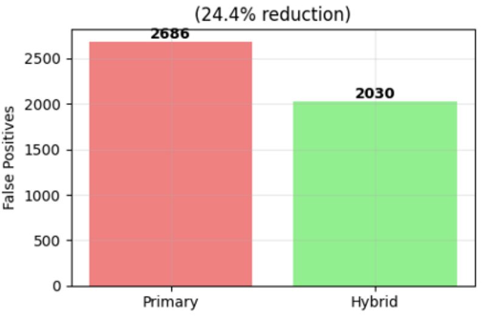
*False positives drop from 2,686 to 2,030 when moving from the baseline to the hybrid model (thesis Fig. 6.10).*

## Final results on DeftPunk

Table 6.8: PSO-optimized hybrid vs. baseline (5 s window)

| Metric | Baseline (CNN-LSTM) | Optimized hybrid (PSO-XGBoost) |
|---|---|---|
| Accuracy (%) | 79.25 | **92.87** |
| Precision (%) | 36.17 | **70.75** |
| Recall (%) | 76.92 | **77.41** |
| F2-Score (%) | 62.78 | **75.97** |
| AUC (%) | 87.41 | **95.95** |

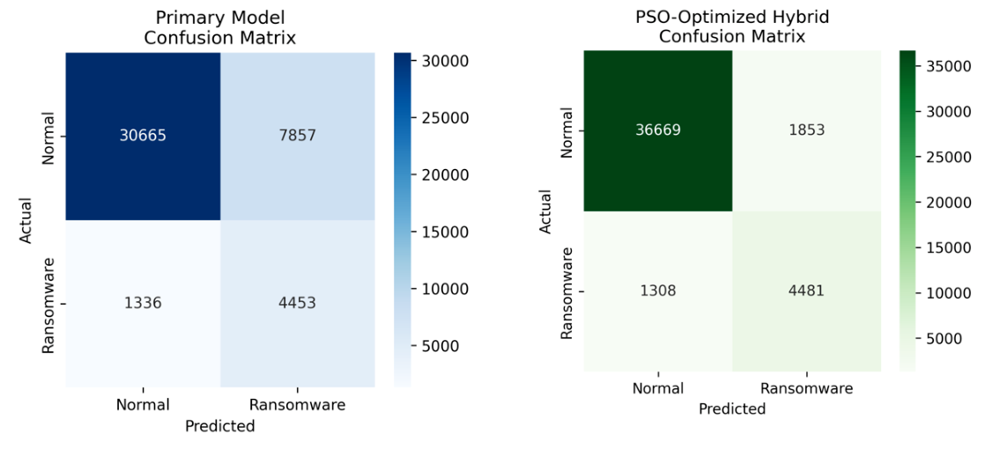
*Confusion matrices of the baseline (left) and the PSO-optimized hybrid (right); false positives fall from 7,857 to 1,853 (thesis Fig. 6.11).*

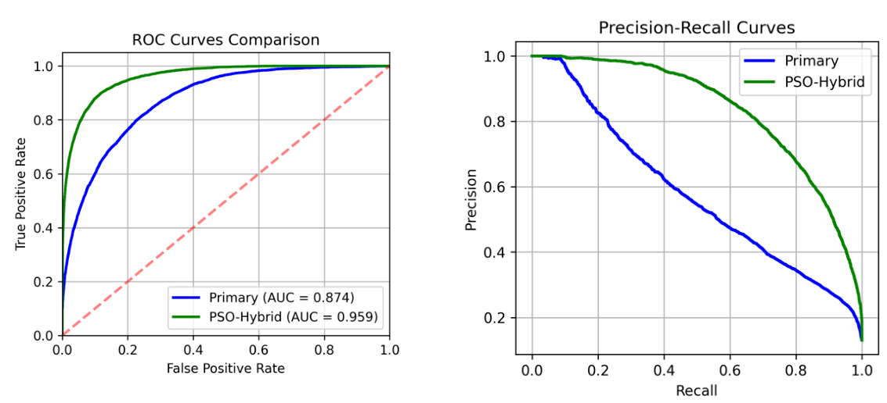
*ROC (AUC 0.874 → 0.959) and precision-recall curves, baseline vs. PSO-optimized hybrid (thesis Fig. 6.12).*

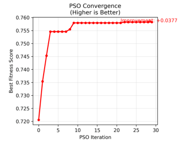
*Best PSO fitness (0.7·F2 + 0.3·Precision) over 30 iterations (thesis Fig. 6.14a).*

## Generalization on RansMap2024

Table 6.9: PSO-optimized hybrid on the balanced RansMap2024 dataset (5 s window)

| Metric | Baseline | Optimized hybrid (PSO-XGBoost) |
|---|---|---|
| Accuracy (%) | 81.49 | **84.83** |
| Precision (%) | 76.46 | **80.22** |
| Recall (%) | 92.38 | **93.49** |
| F2-Score (%) | 88.69 | **90.50** |
| AUC (%) | 92.95 | **94.60** |

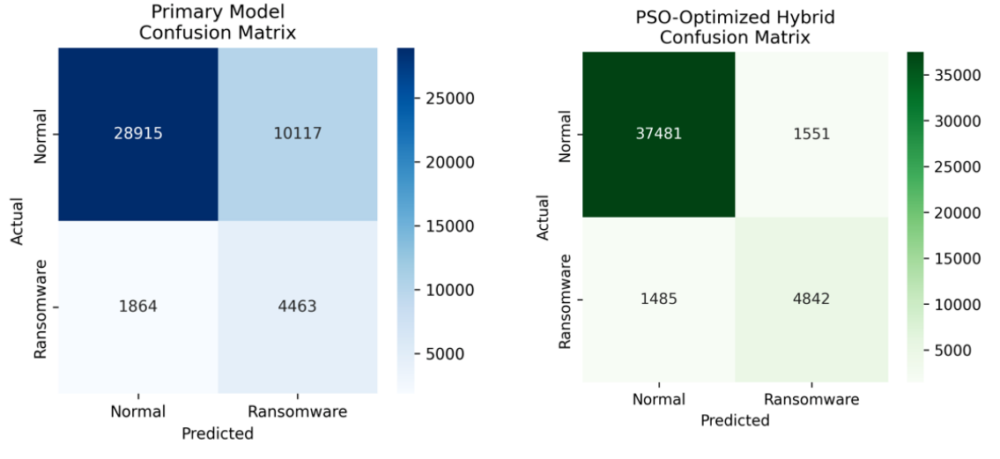
*Confusion matrices on RansMap2024, baseline (left) vs. PSO-optimized hybrid (right) (thesis Fig. 6.16).*

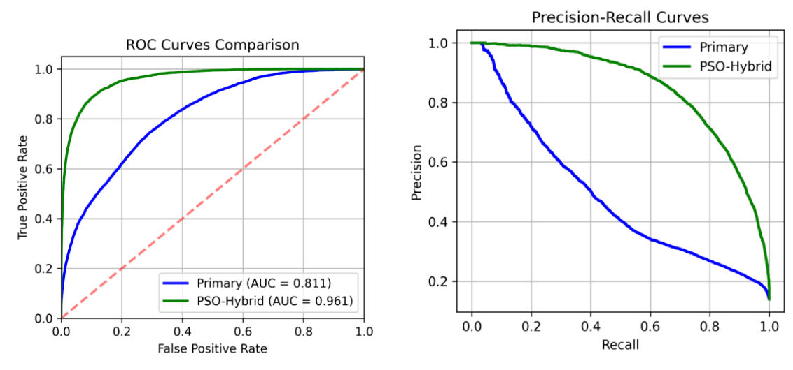
*ROC and precision-recall curves on RansMap2024 (thesis Fig. 6.17).*

> Note: these two figures do not match Table 6.9. The counts in Fig. 6.16 correspond to about
> 14 % ransomware and give, for the hybrid, accuracy 93.31 %, precision 75.74 % and recall 76.53 %.
> The AUCs in Fig. 6.17 (0.961 / 0.811) also differ from Table 6.9 (94.60 / 92.95). The table
> holds the reported results.

## Comparison with the state of the art

Table 6.10 (translated)

| Model | Main strength | Contribution / key difference |
|---|---|---|
| Xception ColSeq [11] | Very high precision in static analysis (98.20 %). | Purely static (vision) approach; fast but potentially less robust to behavioral changes. |
| UNVEIL [6] | Zero false positives in dynamic analysis. | Very reliable against false alarms, but relies on specific heuristics (entropy, SSIM) and sandbox analysis. |
| iCNN-LSTM+ [15] | Incremental learning for continuous adaptation. | Focuses on adapting to new threats, which our static model does not address directly. |
| DeftPunk [13] | Recall close to 100 % and lossless recovery in a specific cloud context. | Specialized for block-level detection, not directly applicable to a standard workstation. Favors recall over precision. |
| SRDC [18] | Excellent generalization to zero-day threats thanks to LLM semantics. | State-of-the-art but very resource-intensive and dependent on an external knowledge corpus. |
| **Our hybrid model (PSO-XGBoost)** | **Excellent precision-recall balance (F2-score 90.50 %) and adaptability to different environments (cloud and PC).** | **Combines deep-learning feature extraction with XGBoost classification, optimized by PSO for the best trade-off.** |

References are numbered as in the thesis bibliography.

## Deployment demo

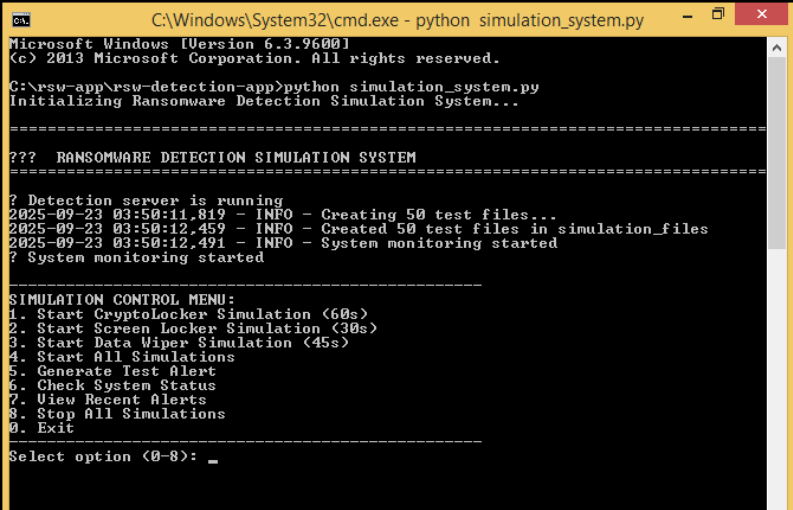
*Interactive menu of the simulation controller used to launch the attack scenarios (thesis Fig. 7.3).*

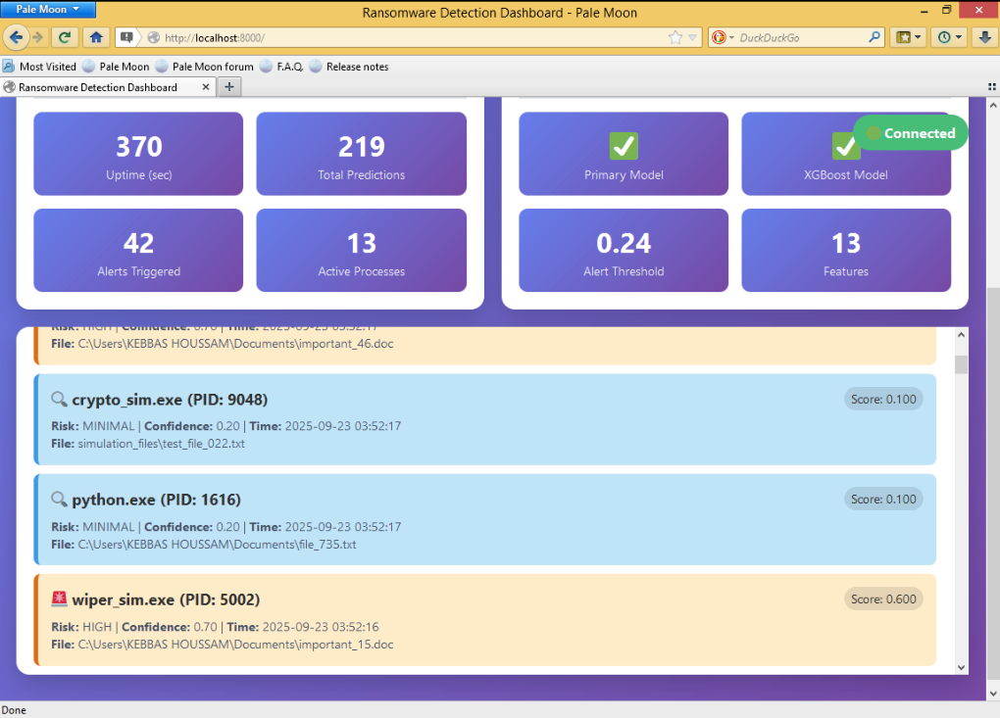
*Real-time dashboard showing alerts during a simulation (thesis Fig. 7.4). This screenshot is from the earlier Flask prototype (rsw-detection-app), not the FastAPI app in this repository.*
